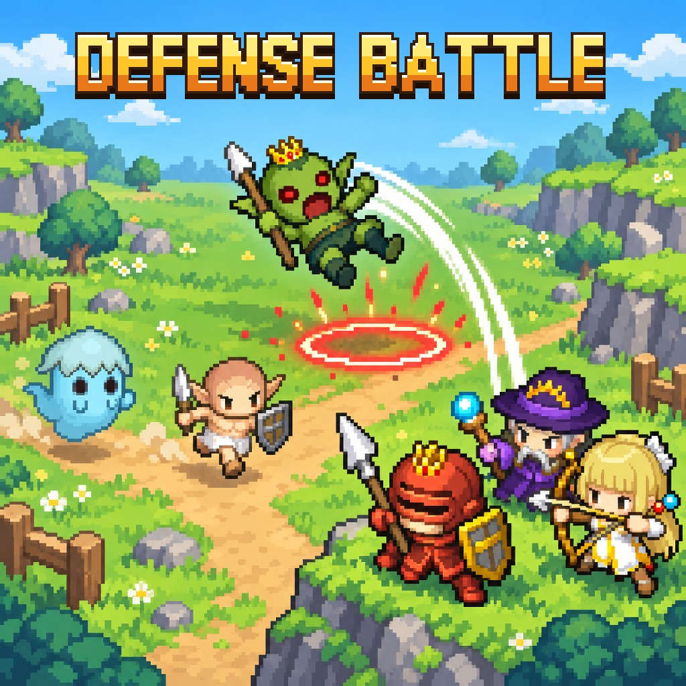
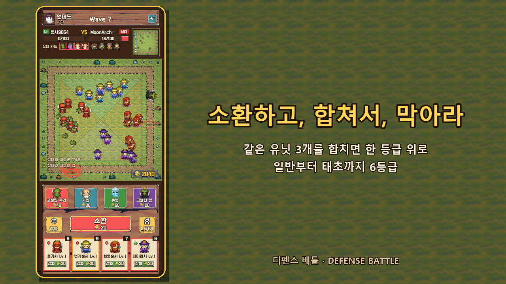
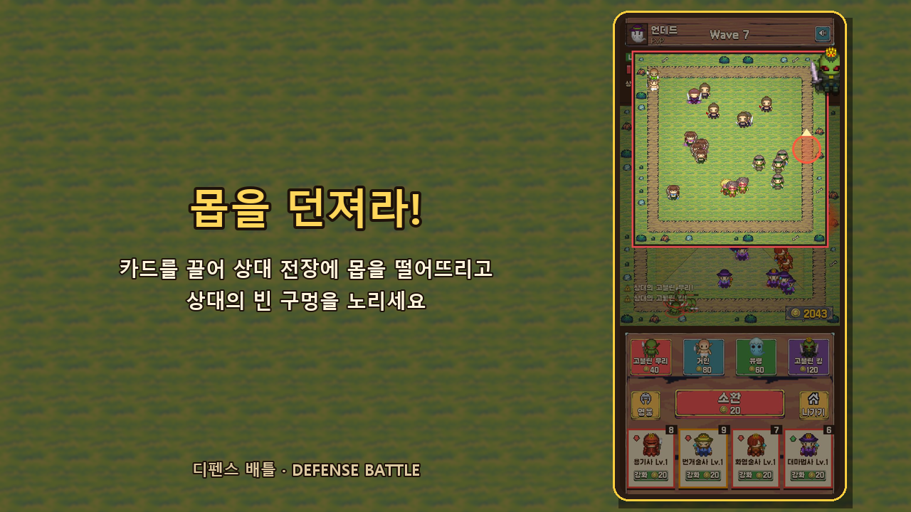
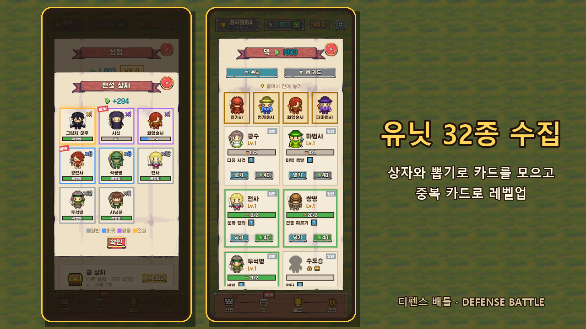
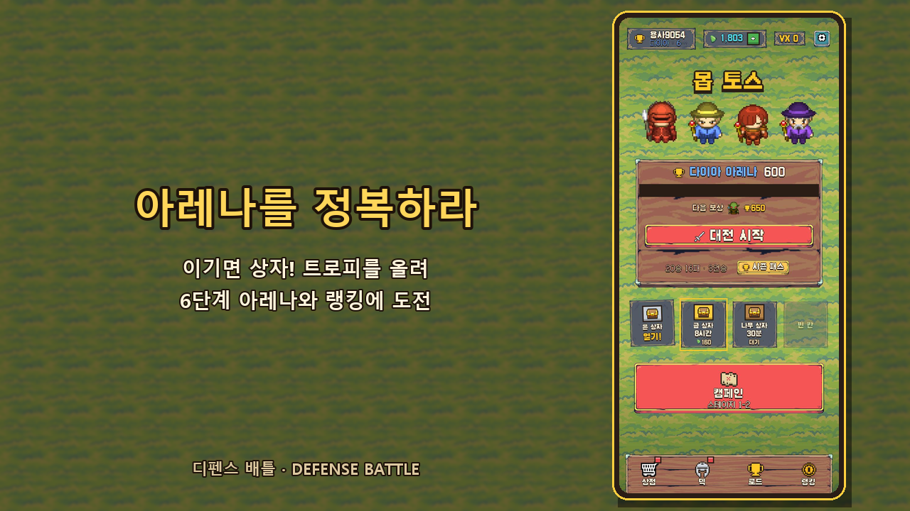

# 디펜스 배틀 (Defense Battle)

> 소환은 운, 승리는 판단.

유닛을 소환·합성해 몰려오는 몹을 막고, 대전에서는 몹 카드를 상대 전장에 던져 무너뜨리는 1:1 실시간 디펜스 대전 게임입니다.
Verse8(Agent8) 플랫폼에 배포했고, 설치 없이 브라우저에서 바로 돌아갑니다. 세로 화면에 맞췄고, 터치(클릭)만으로 조작합니다.
AI와 바이브 코딩으로 만들었습니다.

**▶ 플레이: https://create.verse8.io/creations/R8q8S8y**

  

## 어떤 게임인가

사각 링 모양의 길을 따라 몹이 끝없이 돌고, 그 안쪽에 내 유닛을 세워 막습니다. 길에 몹이 **100마리** 쌓이면 패배.
버튼 하나로 유닛을 뽑고, 같은 유닛 3개를 합쳐 더 강하게 키우는 것이 기본입니다. 여기에 **상대에게 몹을 던지는 PvP**를
얹어서 "내 전장을 지킬까, 상대를 공격할까"를 매 순간 고르게 했습니다.

- **소환 → 합성 → 강화 → 배치.** 소환은 랜덤이지만, 어떤 유닛을 합치고 어디에 둘지는 플레이어의 판단입니다.
- **같은 웨이브를 동시에.** PvP에서는 두 사람이 똑같은 웨이브를 막으며, 모은 골드를 방어에 쓸지 공격에 쓸지 정합니다.
- **상성이 있는 몹.** 몹 카드마다 잘 막는 유닛이 달라서, 상대 덱을 보고 카드를 골라야 합니다.

  
  

## 주요 기능

**전투**
- 같은 유닛 3개를 합치면 한 등급 위로. **일반부터 태초까지 6등급**이고, 합성할 때마다 공격력이 크게 뛰어오릅니다.
- 직업마다 투사체와 스킬이 달라서 보는 맛이 있습니다. 범위 폭발·빙결, 치명타, 합성 연출, 보스 등장 흔들림까지 들어 있습니다.
- 유닛은 자기 구역 앞쪽만 지킵니다. 어떤 유닛도 닿지 않는 길은 **빨간 구멍**으로 표시되고, 구역을 끌어 바꿔서 메웁니다.

**PvP 실시간 1:1**
- 카드를 끌어 상대 전장에 몹을 떨어뜨립니다. 받는 쪽엔 착지 지점에 경고 고리가 뜨고, 던지는 쪽엔 포물선과 화면 흔들림이 나옵니다.
- **몹 카드 16종** 중 4장을 골라 덱을 짭니다. 유령은 물리 피해를 줄이고, 방패병은 화살을, 돌 골렘은 마법을 막습니다.
  고블린 킹은 졸개를 부르고, 번식 유령은 복제되고, 그림자 도적은 숨어서 직접 노릴 수 없습니다.
- 상대 창 아래에는 상대의 몹 카드와 유닛 덱이 보여서, 무엇이 날아올지 읽고 대응합니다.
- 트로피를 모아 **6단계 아레나**를 오르고, 시즌 패스와 랭킹에 도전합니다. 매칭 상대가 없으면 실제 유저처럼 움직이는 봇과 붙습니다.

**수집과 성장**
- 유닛 **32종**(일반 8 · 희귀 10 · 영웅 8 · 전설 6). 대전에서 이기면 상자를 얻고, 상자와 뽑기에서 카드를 모읍니다.
  카드 한 장이 해금, 이후 겹치는 카드는 레벨업 재료입니다.
- 유닛 덱 4칸과 몹 카드 덱 4칸을 카드를 끌어다 놓아 편성합니다. 처음엔 추천 덱을 한 번에 장착할 수 있습니다.
- 트로피 로드: 트로피가 오를 때마다 보석, 상자, 새 유닛, 새 몹 카드가 열립니다.

  
  

**싱글 플레이**
- **캠페인** 3챕터 × 10스테이지(초원의 관문 · 어둠의 숲 · 망자의 성채). 별 3개에 도전하고, 첫 클리어 보상으로 유닛이 해금됩니다.
- **무한 모드** 50웨이브 생존.
- 1-1에서 소환 → 합성 → 강화 → 상성/배치를 한 단계씩 알려 주는 튜토리얼이 있고, 처음 3판은 가장 약한 봇이 상대라
  첫 대전에서 이겨 보는 경험을 줍니다.

**운영 요소**
- 일일 퀘스트, 상점, 시즌 패스(무료·프리미엄 트랙), 한정 특가 팝업.
- Verse8 VX Shop 결제와 보상형 광고(결과 보상 2배, 실패 시 1회 부활, 유닛 뽑기권). 전면 광고는 쓰지 않습니다.
- 보석·상자·카드·결제 같은 재화는 서버가 계산하고 저장해서, 기기에서 저장값을 고쳐도 반영되지 않습니다.
- **5개 언어**: 한국어 · English · 日本語 · 简体中文 · 繁體中文. 처음엔 기기 언어를 따르고 설정에서 바꿉니다.

## 밸런스

수치는 자동 플레이 시뮬레이터로 맞췄습니다.
- 캠페인은 누구나 깰 수 있게 쉽게, 무한 모드는 연구를 쌓을수록 50웨이브에 가까워지게 설계했습니다.
- 대전 한 판은 약 3~4분이고, 플레이어와 봇 시뮬레이션 기준 승률은 50% 중반입니다.
- 대전만 해도 유닛 5종 해금까지 약 2.5시간, 캠페인을 함께 하면 더 빨리 열립니다.

## 개발

- 플랫폼: Verse8(Agent8) 게임 서버, VX Shop, 보상형 광고
- 개발 방식: AI와 바이브 코딩
- 기획·밸런스·운영 설계 문서: [`docs/GDD.md`](docs/GDD.md), 구현과 서버 설계 메모: [`docs/DEV_NOTES.md`](docs/DEV_NOTES.md)

## 에셋 출처

| 에셋 | 사용처 | 라이선스 |
| --- | --- | --- |
| [Tiny Swords](https://pixelfrog-assets.itch.io/tiny-swords) (Pixel Frog) | 맵 지형·장식, UI 버튼·종이·나무·리본 | 구버전 CC0 / Free Pack: 상업 이용 가능, 원본 팩 재배포 금지 |
| [Kenney 1-Bit Pack](https://kenney.nl/assets/1-bit-pack) | UI 아이콘(색 입혀 가공) | CC0 |
| [Galmuri](https://github.com/quiple/galmuri) (Lee Minseo) | 픽셀 폰트 | SIL OFL 1.1 |
| [ぴぽや Pipoya](https://pipoya.net/) 32x32 파츠 (CharaMEL) | 유닛·몹 캐릭터 | 상업 이용·수정 가능, 소재 재배포 금지 |
| [Mixkit](https://mixkit.co/) | 효과음, BGM | Mixkit Free License: 상업 이용 가능, 표기 불필요, 원본 단독 재판매 금지 |
